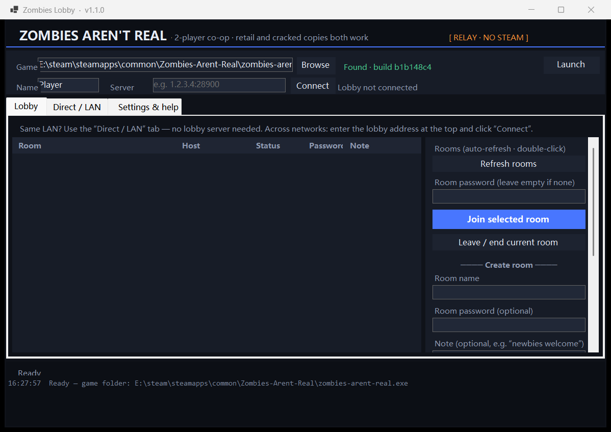
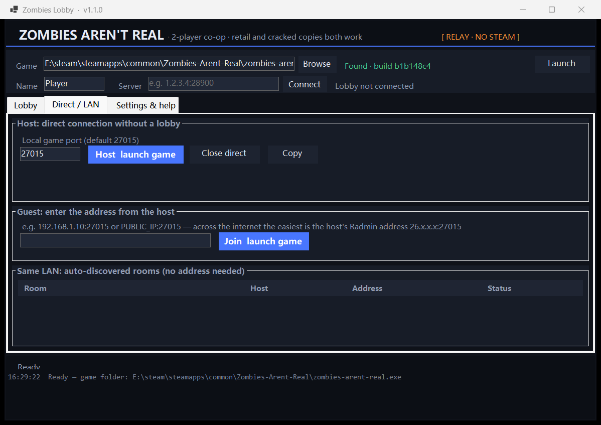
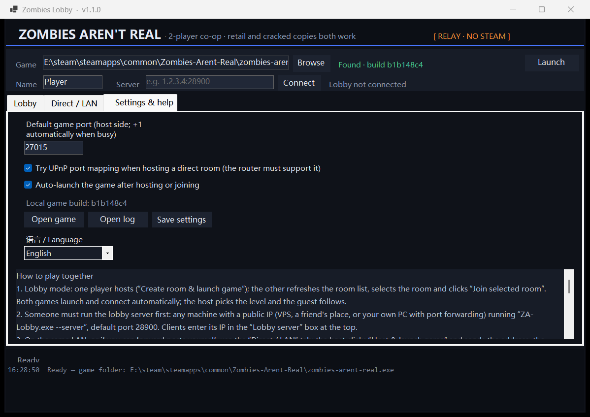
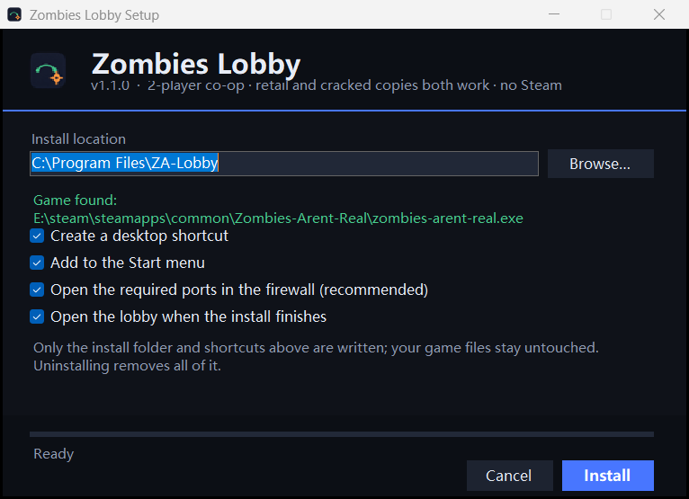
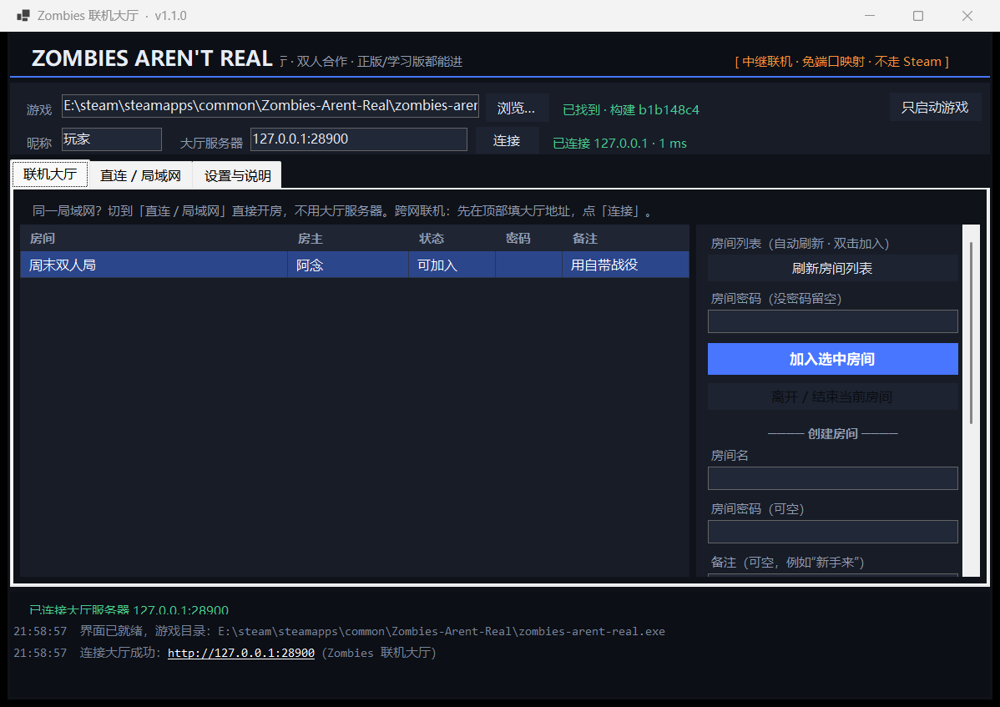

# Zombies Lobby — co-op launcher for *Zombies Aren't Real*

A tiny Windows companion app that lets two players start a **2-player co-op session without Steam**, using the game's own TCP direct-link mode (`--coop-host` / `--coop-join`). One EXE, no Steam login, no port-forwarding wizard to read: pick "Host" on one PC, "Join" on the other.

Because the lobby only speaks the game's TCP protocol and never touches Steam, a copy bought on Steam and a copy launched outside Steam can play together — as long as the game builds match.

> This project contains **no game files**. You need your own copy of *Zombies Aren't Real*. The tool only launches the game you already have and connects the two sessions over TCP.



## Features

- **Two ways to play**
  - **Direct / LAN** – zero setup when both PCs share a Wi-Fi/router: host prints `192.168.x.x:27015`, the other player pastes it.
  - **Lobby** – optional relay server (HTTP 28900 + tunnel 28901), so players behind CGNAT or locked-down routers can still join; no router configuration on either side.
- **Automatic game discovery** – finds the game via Steam library folders and common paths, and shows the detected build (`b1b148c4`).
- **Ports & firewall** – installer opens the needed TCP/UDP rules; UPnP is attempted too (failure is only informational).
- **Language switch** – 中文 / English, in-app dropdown *and* installer (`/LANG=en`), auto-detected from Windows on first run.
- **Command-line friendly** – `--coop-host 27015`, `--coop-join 1.2.3.4:27015`, `--server` for the relay.
- **Dark, compact UI** – one window, three tabs, live log, no console flashing.

## Screenshots

| Direct / LAN | Settings & language | Installer |
|---|---|---|
|  |  |  |

Chinese UI:



## Download

Grab the latest release from the [Releases page](../../releases):

| File | What it is |
|---|---|
| `ZombiesLobby-Setup.exe` | Recommended. Per-user install, desktop + Start-menu shortcuts, firewall rules, uninstaller. |
| `ZombiesLobby-Portable.zip` | Extract anywhere and run `ZA-Lobby.exe`. Nothing is written outside the folder (firewall rules then need to be added manually). |

Windows 10/11 x64. No .NET runtime needed (self-contained). The installer is unsigned, so SmartScreen may show "unknown publisher" — *More info → Run anyway*.

## Quick start — same house / same Wi-Fi

1. **Host** opens the app → tab **Direct / LAN** → **Host and launch game**.
   The game starts with `--coop-host 27015`; the log shows e.g. `192.168.1.41:27015`.
2. **Guest** opens the same tab, pastes that address, clicks **Join and launch game**.
3. Allow the Windows Firewall prompt on first run (the installer already added the rules).

## Different networks, no public IP?

**Option A — virtual LAN (fastest).** Both install [Radmin VPN](https://www.radmin-vpn.com/) or Tailscale, join the same network, and use the `26.x.x.x:27015` address the host prints. Nothing else to configure.

**Option B — run the lobby relay.** Start `ZA-Lobby.exe --server` (or `Lobby Server.bat`) on any machine with a reachable IP, then host creates a room in the **Lobby** tab and the guest joins from the room list. Game traffic is tunnelled through the relay, so neither player needs port forwarding.

**Option C — manual port forward.** Forward TCP `27015` on the host's router and give the guest `your.public.ip:27015`.

## Language

- Installer: picks Windows language, override with `ZombiesLobby-Setup.exe /LANG=en` (or `/LANG=zh`).
- App: tab **Settings and help** → **Language / 语言** → 中文 or English → restart the app.

## Command line

```
ZA-Lobby.exe --coop-host 27015            # host a session on that port
ZA-Lobby.exe --coop-join 1.2.3.4:27015    # join a session
ZA-Lobby.exe --server --port 28900        # start the lobby relay (HTTP 28900, tunnel 28901, rooms 30000-30120)
ZA-Lobby.exe --coop-host --no-launch      # print/apply settings without starting the game
```

## Requirements & limits

- 2 players only — that is the game's own limit.
- Both sides need the **same game build**, same map and same mods.
- Windows only (WinForms, .NET Framework 4.7 target with a self-contained publish).
- The relay needs one reachable host; everything else is peer-to-peer over TCP.

## Troubleshooting

| Symptom | Fix |
|---|---|
| `UPnP automatic mapping failed` | Router has UPnP off. Irrelevant for LAN / Radmin / relay play. |
| Guest cannot connect over the internet | Use Radmin/Tailscale (Option A) — most carriers use CGNAT, so port forwarding often cannot work. |
| Game starts but no session | Check the printed port, allow it in the firewall, and make sure both copies use the same build shown in the header. |
| "Unknown publisher" on install | The EXE is not code-signed; use *More info → Run anyway*. |

## Building from source

```
src/ZALobby        client + relay server (C# WinForms)
installer/         self-contained installer/uninstaller (payload appended to the EXE)
tools/build_setup.ps1   rebuilds both installers (needs .NET Framework 4.7 reference assemblies)
```

```
dotnet publish -c Release -r win-x64 --self-contained true ^
  -p:PublishSingleFile=true -p:EnableCompressionInSingleFile=true -o release
```

## Legal

MIT licensed (see `LICENSE`). Not affiliated with the game's developer or Steam. No game content, no DRM bypass, no Steam emulation is included: this is a convenience launcher/session broker around the game's own direct-link feature. Use it with a copy you are allowed to run.

---

## 中文说明

**Zombies 联机大厅**：给《Zombies Aren't Real》做一个不开 Steam 的双人联机工具，走游戏自带的 TCP 直连（`--coop-host` / `--coop-join`），正版和学习版只要版本一致就能一起玩。

- **直连 / 局域网**：同一 Wi-Fi 下房主点“开房并启动游戏”，把 `192.168.x.x:27015` 发给对方即可。
- **联机大厅**：在任意一台有公网/可映射的机器上跑中继服务，两个玩家都从房间列表进出，不需要各自搞端口映射；也可配合 Radmin VPN / Tailscale 使用。
- **中英双语**：安装时按系统语言自动选择，也可用 `/LANG=en`；程序内“设置与帮助”页可随时切换并重启生效。
- 安装包 58 MB，自带运行库，装完即用；绿色版解压即用。

本仓库不含任何游戏文件，也不提供 Steam 绕过；只调用游戏自身的直连功能。
